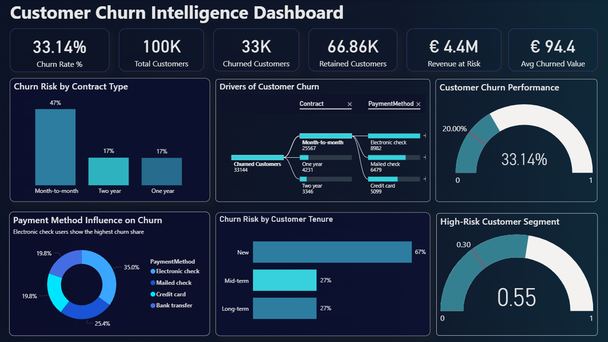
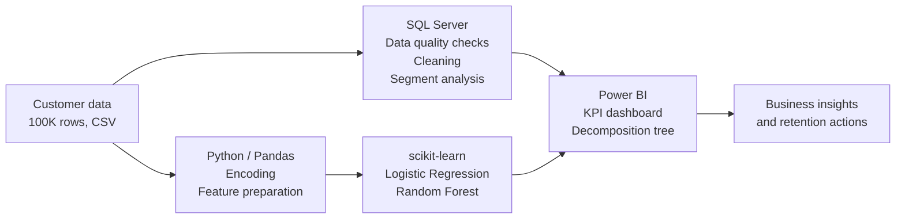

# Customer Churn Intelligence Dashboard

**End-to-end churn analytics on 100,000 customers: SQL analysis, machine learning in Python and an interactive Power BI dashboard that shows who is likely to leave, why, and how much revenue is at risk.**


---

## At a Glance

| Metric | Result |
|---|---|
| Customers analysed | **100,000** |
| Overall churn rate | **33.1%** (33K churned customers) |
| Revenue at risk | **EUR 4.4M** |
| Highest-risk contract | **Month-to-month: 47% churn** (vs. 17% for 1- and 2-year contracts) |
| Highest-risk tenure group | **New customers (< 12 months): 67% churn** |
| Best model | **Random Forest: 75% accuracy, 0.62 F1 on churners** |

---

## Dashboard



The Power BI report answers four business questions on one page:

- **How big is the problem?** KPI cards for churn rate, churned and retained customers, revenue at risk and average churned customer value.
- **Who churns?** Churn risk by contract type and by customer tenure.
- **Why do they churn?** A decomposition tree that breaks churned customers down by contract and payment method.
- **Where should retention focus?** A high-risk segment gauge and payment method influence on churn.

The report file is in [`Churn_Analysis_PowerBI.pbix`](Churn_Analysis_PowerBI.pbix) and can be opened with Power BI Desktop.

---

## Business Problem

A subscription business loses about one in three customers. Every churned customer means lost recurring revenue, and acquiring a new customer costs far more than keeping an existing one.

The goal of this project is to answer three questions:

1. **Which customers are most likely to churn?**
2. **What drives churn?** (contract, tenure, payment method, charges)
3. **How much revenue is at risk, and where should retention efforts focus first?**

---

## Key Insights

1. **Contract type is the strongest driver.** Month-to-month customers churn at **47%**, almost three times the rate of customers on one- or two-year contracts (**17%**). In the model, one- and two-year contracts have by far the strongest negative effect on churn.
2. **The first year is critical.** New customers with less than 12 months of tenure churn at **67%**, compared to **27%** for mid-term and long-term customers.
3. **Payment method matters.** Electronic check users make up the largest share of churned customers (**35%**). The highest-risk path in the decomposition tree is **month-to-month contract + electronic check**.
4. **EUR 4.4M in revenue is at risk** from customers who have already churned or show churn behaviour.

### Business Recommendations

- **Convert month-to-month customers to annual contracts** with a first-year discount or loyalty bonus.
- **Run a structured onboarding programme for the first 12 months**, when churn risk is highest.
- **Encourage automatic payment methods** (bank transfer, credit card) instead of electronic check, for example with a small incentive.
- **Use the model's churn probability** to prioritise the customers the retention team contacts first.

---

## Machine Learning Results

Both models were trained on an 80/20 train-test split (80,000 / 20,000 customers) with class balancing, because churners are the minority class.

| Model | Accuracy | Churn Recall | Churn Precision | Churn F1 |
|---|---|---|---|---|
| Logistic Regression (balanced) | 69% | **70%** | 53% | 0.60 |
| Random Forest (200 trees, balanced) | **75%** | 62% | **62%** | **0.62** |

**How to read this:**

- **Logistic Regression** catches more churners (70% recall). Class balancing raised recall from **47% to 70%**, so the model misses over 40% fewer churners. It's the better choice when missing a churner is expensive.
- **Random Forest** is more accurate overall and produces fewer false alarms. It's the better choice when the retention budget is limited and every contact has to count.

---

## Architecture



---

## Approach

1. **Data quality check (SQL):** row counts, NULL checks on `TotalCharges` and data preview.
2. **Data cleaning (SQL):** removal of incomplete records.
3. **Exploratory analysis (SQL):** churn rate by contract type, payment method and tenure segment, plus a combined contract and customer-stage analysis to find high-risk segments.
4. **Feature preparation (Python):** target encoding (`Churn` to 0/1) and one-hot encoding of categorical variables.
5. **Modelling (scikit-learn):** Logistic Regression and Random Forest with class balancing, evaluated with accuracy, precision, recall, F1 and confusion matrices.
6. **Driver analysis:** model coefficients to identify which factors increase or reduce churn.
7. **Dashboard (Power BI):** KPI cards, segment charts, decomposition tree and risk gauges for business users.

---

## Tech Stack

| Area | Tools |
|---|---|
| Data analysis | SQL (SQL Server / SSMS) |
| Data preparation | Python, Pandas |
| Machine learning | scikit-learn (Logistic Regression, Random Forest) |
| Visualisation | Power BI, Matplotlib |
| Environment | Jupyter Notebook |

---

## Repository Structure

```
customer-churn-intelligence-dashboard/
├── synthetic_customer_churn_100k.csv   # Dataset: 100,000 customers, 9 columns
├── churn_analysis.sql                  # SQL: data quality, cleaning and segment analysis
├── churn_analysis.ipynb                # Python: feature preparation and ML models
├── Churn_Analysis_PowerBI.pbix         # Power BI dashboard
├── Dashboard.png                       # Dashboard screenshot
└── README.md
```

### Dataset

| Column | Description |
|---|---|
| `CustomerID` | Unique customer ID |
| `Age` | Customer age |
| `Gender` | Customer gender |
| `Tenure` | Months as a customer |
| `MonthlyCharges` | Monthly bill |
| `Contract` | Month-to-month, One year, Two year |
| `PaymentMethod` | Electronic check, Mailed check, Bank transfer, Credit card |
| `TotalCharges` | Total amount billed |
| `Churn` | Yes / No (target) |

The dataset is synthetic and was generated to mirror the structure of a typical telecom churn dataset at a larger scale.

---

## How to Run

```bash
# 1. Clone the repository
git clone https://github.com/Mayureshp21/customer-churn-intelligence-dashboard.git
cd customer-churn-intelligence-dashboard

# 2. Install dependencies
pip install pandas scikit-learn matplotlib jupyter

# 3. Open the notebook
jupyter notebook churn_analysis.ipynb
```

- **SQL:** import the CSV into a SQL Server table called `customers` and run `churn_analysis.sql` in SSMS.
- **Dashboard:** open `Churn_Analysis_PowerBI.pbix` in Power BI Desktop.

---

## Next Steps

- Add **feature scaling** and **hyperparameter tuning** (GridSearchCV) to improve both models.
- Test **gradient boosting** (XGBoost or LightGBM) and compare with the Random Forest.
- Score every active customer with a **churn probability** and push the scores into Power BI as a live risk list.
- Calculate the **expected revenue saved** per retention campaign to support budget decisions.

---

## Author

**Mayuresh Parche**
M.Sc. Software Engineering, Hochschule Heilbronn | SAP Certified Data Analyst (SAP Analytics Cloud)

[LinkedIn](https://www.linkedin.com/in/mayureshparche/) | [GitHub](https://github.com/Mayureshp21)

